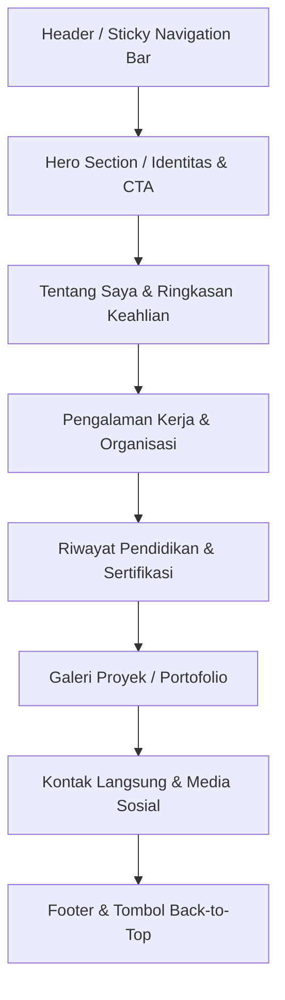

# Product Requirement Document (PRD)
## Website Portofolio Pribadi (HTML5 & CSS3)

---

### Informasi Dokumen
- **Nama Dokumen:** Product Requirement Document (PRD) - Website Portofolio Pribadi
- **Target Pemilik Portofolio:** Syifa
- **Status:** Final Draft / Ready for Development
- **Teknologi Utama:** HTML5, CSS3 murni (Modern Vanilla CSS: CSS Variables, Flexbox, Grid)
- **Versi:** 1.0.0

---

## 1. Ringkasan Produk (Product Summary)

### 1.1 Latar Belakang & Deskripsi
Website Portofolio Pribadi ini adalah situs web berbasis web responsif modern berformat *Single Page Application (SPA)* dengan navigasi *smooth scroll*. Website ini dirancang khusus untuk memamerkan identitas profesional, latar belakang pendidikan, rekam jejak pengalaman kerja/organisasi, portofolio proyek-proyek unggulan, serta saluran kontak dan media sosial.

### 1.2 Tujuan Utama (Primary Goals)
1. **Membangun Reputasi & Personal Branding Profesional:** Menampilkan citra diri yang kredibel dan kompeten bagi perekrut (*recruiter*), instansi, atau calon klien.
2. **Sentralisasi Informasi:** Menjadi pusat satu pintu (*single source of truth*) untuk mengakses CV, demo proyek, sertifikat, serta tautan ke media sosial dan GitHub/LinkedIn.
3. **Kinerja Tinggi & Aksesibilitas:** Memastikan waktu muat (*page load time*) di bawah 1.5 detik, ramah SEO, dan dapat diakses dengan mulus dari semua jenis perangkat (ponsel cerdas, tablet, dan komputer desktop).

---

## 2. Sasaran Pengguna & Kebutuhan (Target Audience & Personas)

| Target Pengguna | Kebutuhan Utama | Ekspektasi Desain |
| :--- | :--- | :--- |
| **Perekrut / Tim HR / Talent Acquisition** | Melihat profil ringkas, mengunduh CV, memeriksa latar belakang pendidikan & pengalaman secara runut | Tata letak jelas (*scannable*), informasi to-the-point, tombol "Unduh CV" mudah ditemukan |
| **Calon Klien / Mitra Bisnis** | Mengevaluasi kualitas proyek yang pernah diselesaikan, studi kasus, dan *tech stack* | Galeri proyek visual yang rapi, tautan demo/preview aktif, deskripsi dampak proyek |
| **Rekan Profesional & Komunitas** | Terhubung melalui jaringan profesional (LinkedIn, GitHub, Instagram) | Ikon media sosial yang jelas, tautan kontak langsung (Email / WhatsApp) |

---

## 3. Arsitektur Informasi & Alur Halaman (Page Architecture)

Website ini mengadopsi model *Single-Page Layout* yang tersusun secara hierarki kronologis dan fungsional:



---

## 4. Rincian Fitur & Spesifikasi Komponen

### 4.1 Header & Navigasi (Sticky Navbar)
- **Komponen:**
  - **Logo/Branding:** Teks nama profesional (misal: `Syifa.` / `Syifa | Portfolio`).
  - **Menu Navigasi Desktop:** Tautan pintas *smooth scroll* (`#about`, `#experience`, `#education`, `#projects`, `#contact`).
  - **Mobile Navigation:** Tampilan menu responsif (hamburger button / clean mobile bar).
  - **Perilaku:** *Sticky* atau *Fixed* di bagian atas layar dengan sedikit efek *backdrop-filter* (blur) saat digulir.

### 4.2 Hero Section (Bagian Identitas Utama)
- **Komponen:**
  - **Greeting & Nama:** *"Halo, saya [Nama Lengkap/Syifa]"*.
  - **Headline Profesi:** Badge / sub-judul (contoh: *Web Developer / UI/UX Designer / Professional*).
  - **Bio Ringkas:** 2–3 kalimat pengantar yang memikat mengenai spesialisasi, ketertarikan karir, dan nilai tambah diri.
  - **Foto Profil:** Foto formal/semi-formal beresolusi tinggi dengan bingkai modern (lingkaran/squircle beraksen gradient/glow).
  - **Call-to-Action (CTA):**
    - Tombol Utama: **"Unduh CV"** (langsung membuka/mengunduh file PDF).
    - Tombol Sekunder: **"Hubungi Saya"** (scroll instan ke bagian kontak).

### 4.3 Bagian Tentang Saya & Keahlian (About & Skills)
- **Komponen:**
  - Narasi profesional lebih mendalam mengenai latar belakang, minat, dan filosofi kerja.
  - **Keahlian Teknis & Non-Teknis (Skills Badges/Chips):**
    - Hard skills: HTML5, CSS3, JavaScript, UI Design (Figma), Git, dll.
    - Soft skills: Problem Solving, Teamwork, Communication, Time Management.

### 4.4 Bagian Pengalaman Kerja & Organisasi (Experience Section)
- **Tampilan:** Desain *Timeline* vertikal modern atau kartu bertingkat (*cards*).
- **Elemen per item pengalaman:**
  - Posisi / Jabatan kerja.
  - Nama Perusahaan, Lembaga, atau Organisasi.
  - Lokasi (Kota/Remote).
  - Periode waktu (Bulan & Tahun mulai – selesai / Saat ini).
  - Poin-poin deskripsi tanggung jawab dan pencapaian konkrit.

### 4.5 Bagian Pendidikan (Education Section)
- **Tampilan:** Kartu modular (*grid/cards*) yang rapi dan konsisten.
- **Elemen per item pendidikan:**
  - Nama Institusi / Universitas / Sekolah.
  - Gelar / Jenjang & Program Studi / Jurusan.
  - Tahun kelulusan (atau perkiraan tahun lulus).
  - Keterangan relevan (IPK/Nilai, fokus keilmuan, penghargaan, atau mata kuliah unggulan).

### 4.6 Bagian Portofolio Proyek (Projects Section)
- **Tampilan:** Layout Grid responsif (1 kolom di mobile, 2 atau 3 kolom di desktop).
- **Elemen per kartu proyek:**
  - **Thumbnail / Tangkapan Layar Proyek:** Visual representatif dengan efek hover zoom halus.
  - **Judul Proyek:** Nama proyek yang jelas.
  - **Deskripsi:** Ringkasan masalah yang diselesaikan dan fungsi proyek (2-3 kalimat).
  - **Pills/Badges Tech Stack:** Menampilkan teknologi yang digunakan (misal: `HTML5`, `CSS3`, `JavaScript`).
  - **Tautan Aksi:**
    - Tombol **"Lihat Demo"** (Live Preview URL).
    - Tombol **"Source Code"** (GitHub repository link).

### 4.7 Bagian Kontak & Media Sosial (Contact Section)
- **Tampilan:** Terbagi menjadi 2 kolom/blok:
  1. **Informasi Kontak Langsung & Media Sosial:**
     - Alamat Email (dengan link `mailto:`).
     - WhatsApp (dengan link langsung `https://wa.me/...`).
     - Domisili / Lokasi (misal: Jakarta, Indonesia).
     - Tautan Media Sosial (LinkedIn, GitHub, Instagram) lengkap dengan ikon interaktif.
  2. **Formulir Kontak (Contact Form):**
     - Field: Nama Lengkap, Alamat Email, Subjek/Perihal, dan Pesan.
     - Tombol "Kirim Pesan" dengan efek hover interaktif.

### 4.8 Footer
- Teks Hak Cipta: `© 2026 Syifa. All Rights Reserved.`
- Tautan kembali ke atas (*Back to Top* button) dengan animasi transisi halus.

---

## 5. Panduan Desain & UI/UX (Design System)

### 5.1 Palet Warna (Color Palette)
Menggunakan CSS Variables agar mudah disesuaikan (mendukung mode terang/gelap):
- **Primary / Background:**
  - Dark Theme: `#0f172a` (Slate 900) & `#1e293b` (Slate 800 untuk kartu)
  - Light Theme: `#f8fafc` (Slate 50) & `#ffffff` (White untuk kartu)
- **Accent / Highlight:**
  - `#3b82f6` (Royal Blue) atau `#6366f1` (Indigo) untuk nuansa teknologi dan profesionalisme.
  - `#10b981` (Emerald Green) untuk indikator status (misal: "Available for Work").
- **Teks:**
  - Teks Utama: `#f1f5f9` (Slate 100) atau `#0f172a` (Slate 900)
  - Teks Sekunder / Keterangan: `#94a3b8` (Slate 400) atau `#64748b` (Slate 500)

### 5.2 Tipografi
- **Font Utama:** Menggunakan Google Fonts modern seperti `Inter` atau `Plus Jakarta Sans`.
- **Hierarki:**
  - `h1` (Hero Headline): `2.5rem` – `3.25rem`, Bold (700)
  - `h2` (Section Titles): `1.85rem` – `2.25rem`, Semi-Bold (600)
  - `h3` (Card Titles): `1.25rem` – `1.4rem`, Medium (500)
  - Body Text: `1rem` (16px), Line Height `1.6`, Regular (400)

### 5.3 Breakpoints & Responsivitas
- **Mobile (< 768px):** Tata letak satu kolom, menu navigasi terkompresi, padding adaptif.
- **Tablet (768px – 1024px):** Grid 2 kolom pada portofolio dan kontak.
- **Desktop (> 1024px):** Layout penuh maksimal `max-width: 1200px` di tengah (*margin: 0 auto*), grid 3 kolom untuk proyek.

---

## 6. Arsitektur Teknis & Struktur File

### 6.1 Struktur Folder Proyek
```
PORTOFOLIO SYIFA/
├── PRD.md                     # Dokumen persyaratan produk ini
├── index.html                 # Halaman utama portofolio semantik
├── css/
│   └── style.css              # File stylesheet utama terstruktur
├── assets/
│   ├── images/                # Foto profil dan tangkapan layar proyek
│   │   ├── profile.jpg
│   │   ├── project-1.jpg
│   │   ├── project-2.jpg
│   │   └── project-3.jpg
│   └── icons/                 # Ikon SVG (Sosial media, kontak, tech stack)
└── docs/
    └── CV-Syifa.pdf           # File CV yang dapat diunduh
```

### 6.2 Standar Kualitas Kode
1. **HTML5 Semantik:** Menggunakan tag semantik resmi (`<header>`, `<nav>`, `<main>`, `<section>`, `<article>`, `<footer>`) demi aksesibilitas dan SEO.
2. **CSS3 Modern:**
   - Memakai CSS Custom Properties (`:root { --primary: ...; }`) untuk fleksibilitas tema.
   - Pemanfaatan *CSS Grid* dan *Flexbox* murni tanpa dependensi library eksternal yang lambat.
   - Efek transisi halus (`transition: all 0.3s ease`).
3. **Cross-browser Compatibility:** Kompatibel di Google Chrome, Mozilla Firefox, Microsoft Edge, dan Safari Mobile.

---

## 7. Kriteria Keberhasilan & Acceptance Criteria (QA)

| No | Kriteria Uji | Kondisi Diharapkan | Status |
| :- | :--- | :--- | :-: |
| 1 | **Kelengkapan Bagian** | Tampil lengkap: Identitas, Pengalaman, Pendidikan, Proyek, dan Kontak. | [ ] |
| 2 | **Responsivitas Layar** | Tampilan presisi di smartphone (360px - 414px), tablet (768px), dan laptop (1366px+). | [ ] |
| 3 | **Navigasi Smooth Scroll** | Klik menu menggeser layar dengan animasi lembut menuju section tujuan. | [ ] |
| 4 | **Fungsi Unduh CV** | Tombol CTA unduh CV mengarahkan ke file PDF secara benar. | [ ] |
| 5 | **Tautan Kontak & Sosmed** | Tautan Email (`mailto:`), WhatsApp, LinkedIn, GitHub, dan Instagram aktif. | [ ] |
| 6 | **Validasi Kode** | Nol error pada validator HTML5 W3C dan CSS3. | [ ] |
| 7 | **Kecepatan Muat** | Skor Google Lighthouse Performance > 90, page load < 1.5 detik. | [ ] |

---

## 8. Rencana Implementasi Bertahap (Next Steps)

1. **Tahap 1 - Kerangka Dasar HTML (`index.html`):** Membuat struktur dokumen semantik lengkap dengan placeholder konten nyata untuk identitas, riwayat, proyek, dan kontak.
2. **Tahap 2 - Tata Letak & Desain CSS (`css/style.css`):** Mengimplementasikan CSS variables, styling komponen kartu, timeline pengalaman, tata letak grid, dan efek hover.
3. **Tahap 3 - Optimasi Responsif & Interaktivitas:** Menambahkan media queries untuk tampilan mobile yang sempurna dan animasi smooth scroll.
4. **Tahap 4 - Integrasi Aset & Personalisasi:** Memasukkan foto profil, gambar proyek, dan dokumen CV asli milik Syifa.
